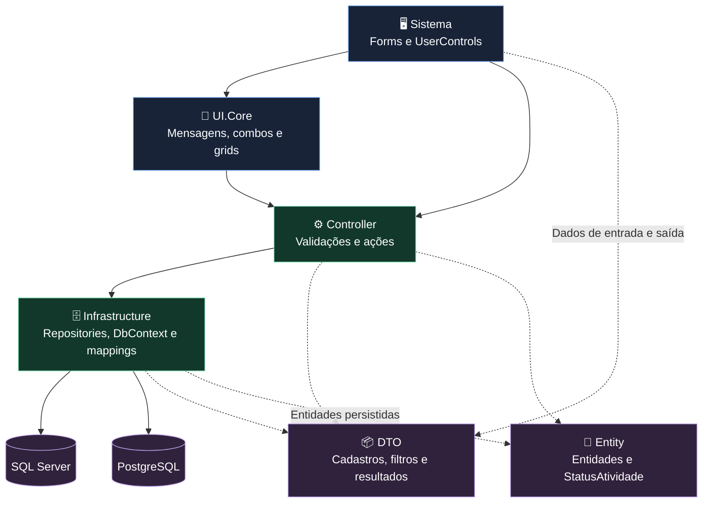

<p align="center">
  
</p>

# JustDoTheWork

**Organize a atividade. Execute com contexto. Acompanhe cada etapa.**

O JustDoTheWork é uma aplicação desktop para Windows que reúne projetos, atividades, registros de execução e cadastros em um só lugar. Você descreve o que precisa ser feito, acompanha o trabalho entre pendências, execução e pausas e consulta quando cada período de execução começou e terminou.

Desenvolvido em **C# e .NET 8**, com **Windows Forms**, **DevExpress** e persistência via **Entity Framework Core**, o projeto possui configurações para **SQL Server e PostgreSQL**.

<p align="center">
  <strong>Versão 1.5.0</strong> · Windows Desktop · Interface em português · Tema escuro
</p>

<p align="center">
  <a href="#funcionalidades">Funcionalidades</a> ·
  <a href="#fluxo">Fluxo de trabalho</a> ·
  <a href="#versao-150">Novidades da 1.5.0</a> ·
  <a href="#executar">Como executar</a> ·
  <a href="#arquitetura">Arquitetura</a>
</p>

---

<a id="funcionalidades"></a>

## 🧭 O que você pode fazer

| Área | Ações disponíveis |
| --- | --- |
| 🗂️ **Projetos e atividades** | Criar um projeto durante o cadastro da atividade; incluir atividades com nome, projeto e descrição formatada; consultar e editar seus dados. |
| 🔎 **Pesquisa de atividades** | Filtrar por nome, projeto, status e data de criação; limpar os filtros; abrir os detalhes pela ação da grid. |
| ▶️ **Painel de execução** | Visualizar atividades pendentes, em execução e pausadas; executar, pausar, retomar, voltar para pendente e finalizar. |
| 🕒 **Histórico** | Consultar os períodos de execução, com início e fim; pesquisar por projeto, status e data de criação da atividade. |
| 📝 **Modelos de relatório** | Incluir, pesquisar, editar e excluir modelos; definir seu tipo e ativação; editar o conteúdo em um editor de texto formatado. |
| 👥 **Usuários** | Incluir e editar usuários; pesquisar por nome ou logon; visualizar nome, logon e tipo na listagem. |
| 🔐 **Login** | Conferir o logon cadastrado e verificar a senha com BCrypt. |
| 🔌 **Banco de dados** | Selecionar SQL Server ou PostgreSQL, informar a conexão, testar o acesso e salvar a configuração. |

O menu lateral abre os cadastros e o relatório de execuções em abas. O painel principal reúne os três quadros de trabalho e atualiza suas listagens a cada **10 segundos**.

### Uma interface para acompanhar o trabalho

- **Pendentes, Em execução e Pausado:** três quadros para localizar a atividade e escolher a próxima ação.
- **Grids padronizadas:** mais espaço para textos, IDs e datas centralizados, coluna de ação à direita e larguras ajustadas ao espaço disponível.
- **Detalhes da atividade:** dados do cadastro, descrição e consulta ao histórico de execução.
- **Editor compartilhado:** conteúdo formatado para descrever requisitos e preparar modelos de relatório.
- **Mensagens em português:** validações, confirmações e retornos das operações.

<a id="fluxo"></a>

## 🔄 Progressão e responsáveis

Uma atividade começa **Pendente** com o **Historiador**. Ao avançar, ele escolhe um **Desenvolvedor**; quando o desenvolvimento termina, o responsável escolhe um **QA Tester**. A conclusão do QA finaliza a atividade e registra sua data de encerramento.


Em cada etapa, o responsável pode executar, pausar e retomar o trabalho. Avançar encerra qualquer execução aberta e entrega a atividade como pendente ao próximo responsável. Status, etapa, responsável e períodos de execução são gravados na mesma transação.

As regras de acesso seguem o backend Web, incluindo as consultas por ID:

| Perfil | Tarefas visíveis |
| --- | --- |
| **Historiador** | Todas as atividades, de qualquer responsável, etapa e status. Executa e encaminha somente sua própria etapa. |
| **Tech Lead** | Todas as atividades. Pode editar, cancelar abertas e administrar vínculos, mas não executar, avançar ou concluir etapas. |
| **Desenvolvedor** | Pendentes de Desenvolvimento compartilhadas com a equipe; em execução ou pausadas, somente as próprias. |
| **QA Tester** | Pendentes de Testes compartilhadas com a equipe; em execução ou pausadas, somente as próprias. |

Iniciar uma pendente de Desenvolvimento/Testes assume a atividade e registra o executor na mesma transação. Voltar a Pendente libera a fila normal. O QA pode **Devolver ao desenvolvedor**; essa correção fica reservada ao desenvolvedor anterior, mesmo ao pausar ou voltar a Pendente, até avançar novamente.

Desenvolvedores e testers consultam suas execuções mesmo depois que a atividade muda de etapa. Períodos antigos sem autoria continuam identificados como **Autoria não registrada** e só aparecem a esses perfis enquanto a atividade estiver atribuída ao usuário. Historiador e Tech Lead consultam todos os períodos, gerenciam modelos e imprimem. O menu dos especialistas contém Tarefas e Minhas execuções. Veja [as regras de negócio e a validação](docs/REGRAS_NEGOCIO.md).

O login exige um usuário cadastrado com senha BCrypt e um dos quatro perfis. Não há acesso por credenciais fixas sem validação no banco.

<a id="versao-150"></a>

## ✨ O que chegou na versão 1.5.0

- **Gestão de usuários:** tela de inclusão e edição, busca por nome ou logon, listagem e acesso pelo menu lateral.
- **Tipos de usuário:** Historiador, Desenvolvedor, QA Tester e Tech Lead, utilizando os IDs já existentes no banco.
- **Senhas com BCrypt:** geração de hash ao cadastrar ou trocar a senha e verificação no login. Na edição, deixar a senha em branco mantém a senha atual.
- **Cancelamento de atividades:** ação na tela de detalhes do cadastro.
- **Apresentação das grids:** alinhamentos, proporções de colunas e disposição dos quadros de execução ajustados.
- **Nomenclatura consistente:** nomes de telas, componentes, eventos, métodos e variáveis padronizados, com regras registradas na documentação e na `.editorconfig`.

<a id="uso"></a>

## 🖱️ Um roteiro para conhecer o sistema

1. **Prepare e configure o banco.** Informe o provedor e os dados de conexão na primeira abertura. Salve e reinicie o aplicativo.
2. **Entre no sistema.** Use um usuário do banco com senha no formato BCrypt; consulte as orientações de primeiro acesso abaixo.
3. **Crie sua primeira atividade.** Acesse **Cadastro → Atividades → Incluir**, selecione um projeto ou crie um pelo botão de adicionar projeto e preencha a descrição.
4. **Revise e avance.** Como Historiador, abra a atividade pela lupa e use **Avançar etapa** para escolher um Desenvolvedor. O Desenvolvedor encaminha ao QA Tester, que finaliza a atividade.
5. **Execute o trabalho.** Na aba **Execução de Tarefas**, use os ícones na linha da atividade; passe o mouse para consultar a ação de cada botão. Pendentes podem executar; atividades em execução podem pausar, voltar para pendente ou finalizar; pausadas podem executar ou voltar para pendente. A lupa abre os detalhes e o histórico da atividade.
6. **Consulte os registros.** Acesse **Relatório → Relatório de Execuções**, informe os filtros e pesquise os períodos registrados.
7. **Personalize os cadastros.** Em **Cadastro**, organize os usuários e os modelos de relatório que serão utilizados.

### Modelos de relatório nesta versão

O botão **Imprimir** da tela de histórico gera o documento com os períodos pesquisados e os campos de objeto preenchidos. Exige um modelo ativo de Histórico Execução com conteúdo; quando há mais de um, solicita a seleção. Historiador e Tech Lead podem imprimir entre 1 e 100 períodos por relatório.

<a id="executar"></a>

## 🚀 Como executar

### Requisitos

| Requisito | Utilização |
| --- | --- |
| **Windows** | Execução da interface, cujo projeto utiliza `net8.0-windows`. |
| **SDK do .NET 8** | Compilação dos projetos da solução. |
| **Visual Studio com desenvolvimento desktop em .NET** | Abertura da solução e edição dos formulários Windows Forms. |
| **DevExpress 25.2.5** | Componentes visuais e editor de documentos. É necessário ter acesso aos pacotes da versão, pela fonte NuGet da licença ou pelos pacotes locais da instalação. |
| **SQL Server ou PostgreSQL** | Banco acessível, com as tabelas e os dados iniciais preparados. |

### 1. Obtenha o projeto

```powershell
git clone https://github.com/devsousaleon/JustDoTheWork.git
cd JustDoTheWork
```

Abra [JustDoTheWork.sln](JustDoTheWork.sln) no Visual Studio e selecione **JustDoTheWork.Sistema** como projeto de inicialização.

### 2. Prepare o banco de dados

Crie um banco no provedor escolhido e prepare as tabelas conforme os mappings de [SQL Server](JustDoTheWork.Infrastructure/Mappings/SqlServer/) ou [PostgreSQL](JustDoTheWork.Infrastructure/Mappings/Postgres/):

```text
Projeto ─────── Atividade ─────── Execucao

TipoUsuario ─── Usuario

TipoModelo ──── ModeloRelatorio
```

O arquivo [justdothework_sql.sql](justdothework_sql.sql) contém as seções de criação para SQL Server e PostgreSQL. Crie o banco e execute somente a seção do provedor escolhido. Os quatro tipos de usuário são cadastrados sem assumir seus IDs no código. Descrições e modelos usam documentos Open XML em colunas binárias.

Para bancos existentes, a primeira autenticação válida aplica, em transação, os scripts incorporados de atualização do fluxo. Eles adicionam etapa, responsável, chave estrangeira e índice por responsável/status. O usuário de conexão precisa poder atualizar a estrutura nessa primeira execução. Também é possível executar o script do provedor manualmente, dentro de uma transação, antes de iniciar o aplicativo.

As atividades antigas em Análise passam para Pendente; as já finalizadas recebem a etapa Finalizada. Nenhum responsável é escolhido automaticamente para registros antigos. O Tech Lead consulta as atividades sem vínculo e usa **Vincular responsável** nos detalhes para destiná-las ao profissional da etapa.

### 3. Restaure os pacotes e inicie

Com a fonte dos pacotes DevExpress configurada, execute pelo Visual Studio ou utilize:

```powershell
dotnet restore JustDoTheWork.sln
dotnet build JustDoTheWork.sln -m:1
dotnet run --project JustDoTheWork.Sistema/JustDoTheWork.Sistema.csproj
```

### 4. Configure a conexão

Sem uma conexão configurada, a aplicação abre **Configuração de Banco**:

1. Selecione **SQL Server** ou **PostgreSQL**.
2. Preencha servidor, banco, usuário e senha do banco.
3. Use **Testar conexão** para conferir o acesso.
4. Salve a configuração e reinicie o aplicativo, conforme a mensagem exibida.

A configuração salva utiliza a proteção `DataProtectionConfigurationProvider` do Windows. O usuário e a senha desta tela são credenciais do **banco de dados**; o login da aplicação usa os registros da tabela **Usuario**.

### 5. Primeiro acesso e usuários

Prepare no banco o primeiro usuário Tech Lead com hash BCrypt, utilizando o ID consultado em TipoUsuario. Depois de entrar com esse usuário, abra **Cadastro → Usuários → Incluir** para cadastrar Historiadores, Desenvolvedores e QA Testers. Cadastros e trocas de senha feitos pela tela geram o hash automaticamente. O tipo do usuário autenticado determina suas permissões e as atividades que pode consultar.

Os perfis determinam o acesso às consultas e operações. Usuários antigos com senha em texto precisam ter a senha atualizada pela tela de cadastro para utilizar a verificação BCrypt. Os hashes não são enviados aos formulários de edição; deixar a senha em branco preserva o hash no banco.

<a id="arquitetura"></a>

## 🏗️ Como o projeto está organizado

A solução separa a interface, os dados transportados entre as camadas, as entidades, as ações dos controllers e o acesso ao banco.



| Projeto | Responsabilidade |
| --- | --- |
| [JustDoTheWork.Sistema](JustDoTheWork.Sistema/) | Inicialização, login, menu, formulários e UserControls. |
| [JustDoTheWork.Controller](JustDoTheWork.Controller/) | Validações, operações de cadastro, transições do painel e composição dos controllers. |
| [JustDoTheWork.DTO](JustDoTheWork.DTO/) | Objetos de cadastro, filtros de pesquisa e resultados das consultas. |
| [JustDoTheWork.Entity](JustDoTheWork.Entity/) | Entidades persistidas e enumeração dos status das atividades. |
| [JustDoTheWork.Infrastructure](JustDoTheWork.Infrastructure/) | Repositories, Entity Framework Core, configuração dos provedores e mappings. |
| [JustDoTheWork.UI.Core](JustDoTheWork.UI.Core/) | Serviços compartilhados de mensagens, combos e apresentação das grids. |

O acesso aos dados dos cadastros e das pesquisas utiliza **Entity Framework Core e LINQ**. Os mappings de cada provedor definem tabelas, colunas e relacionamentos. A `CompositionRoot` monta os controllers e repositories a partir da conexão selecionada.

### Tecnologias da versão

| Tecnologia | Papel no projeto |
| --- | --- |
| **C# / .NET 8** | Linguagem e plataforma da aplicação. |
| **Windows Forms** | Interface desktop para Windows. |
| **DevExpress 25.2.5** | Formulários, grids, menu, abas e editor de documentos. |
| **Entity Framework Core 8** | Persistência, consultas e transações. |
| **SQL Server / Npgsql** | Provedores de acesso aos bancos SQL Server e PostgreSQL. |
| **BCrypt.Net-Next 4.2.0** | Geração e verificação dos hashes de senha. |
| **System.Configuration** | Leitura, gravação e proteção da configuração de conexão. |

## 🤝 Para quem quiser contribuir

O projeto é desenvolvido para estudo e prática de desenvolvimento desktop. Sugestões, relatos de problemas e melhorias podem ser enviados pelas [issues do repositório](https://github.com/devsousaleon/JustDoTheWork/issues).

Ao alterar o código, siga os [padrões de nomenclatura](docs/PADROES_NOMENCLATURA.md), atualize componentes e eventos junto com o Designer e confira o comportamento no provedor de banco utilizado. Explique nas contribuições a mudança realizada e como ela foi verificada.

O repositório ainda não possui um arquivo `LICENSE` com uma licença de uso definida.

---

<p align="center">
  Desenvolvido por <a href="https://github.com/devsousaleon">devsousaleon</a>.<br>
  <strong>Do planejamento ao histórico: cada etapa do trabalho tem seu lugar.</strong>
</p>
