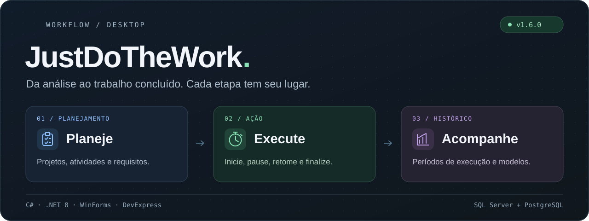
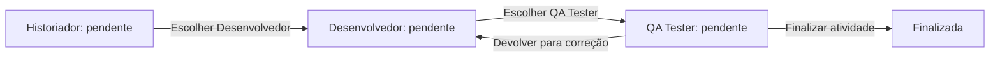
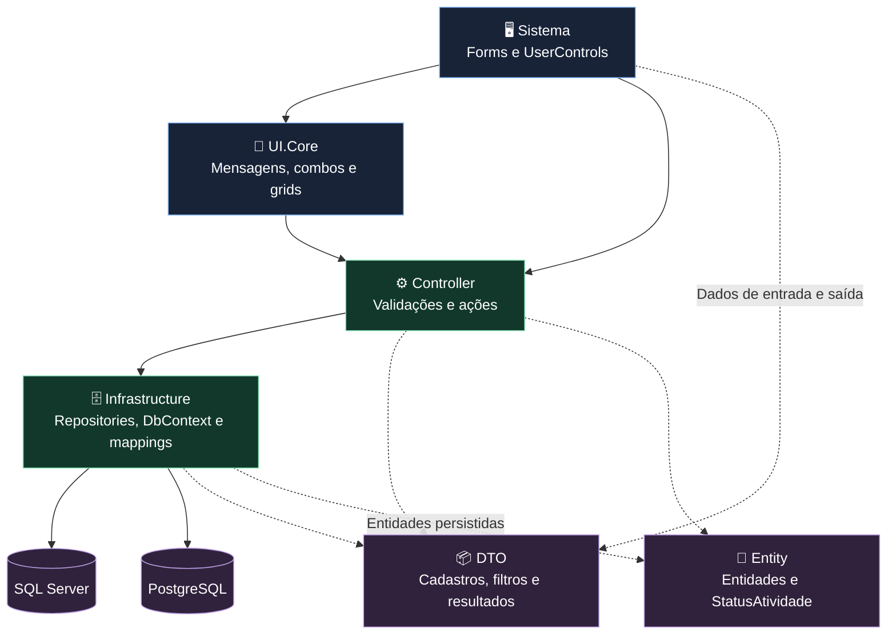

<p align="center">
  
</p>

# JustDoTheWork

O JustDoTheWork é uma aplicação desktop para Windows que organiza projetos e atividades do levantamento de requisitos à conclusão dos testes. O quadro de tarefas mostra o trabalho disponível para cada perfil, e o histórico registra os períodos de execução, seus autores e as etapas em que ocorreram.

Desenvolvido em **C# e .NET 8**, com **Windows Forms**, **DevExpress** e persistência via **Entity Framework Core**, o projeto possui configurações para **SQL Server e PostgreSQL**.

<p align="center">
  <strong>Versão 1.6.0</strong> · Windows Desktop · Interface em português · Tema escuro
</p>

<p align="center">
  <a href="#funcionalidades">Funcionalidades</a> ·
  <a href="#fluxo">Fluxo de trabalho</a> ·
  <a href="#versao-160">Novidades da 1.6.0</a> ·
  <a href="#impressao">Impressão</a> ·
  <a href="#executar">Como executar</a> ·
  <a href="#arquitetura">Arquitetura</a>
</p>

---

<a id="funcionalidades"></a>

## 🧭 O que você pode fazer

| Área | Ações disponíveis |
| --- | --- |
| 🗂️ **Projetos e atividades** | Criar um projeto durante o cadastro da atividade; incluir atividades com nome, projeto e descrição formatada; consultar e editar seus dados. |
| 🔎 **Pesquisa de atividades** | Filtrar por nome, projeto, status e data de criação; limpar os filtros; abrir os detalhes pela ação da grid. |
| ▶️ **Painel de execução** | Acompanhar atividades pendentes, em execução e pausadas. As ações de executar, pausar, retomar, encaminhar e concluir dependem do perfil e da etapa. |
| 🕒 **Histórico** | Consultar início, fim, autor e etapa das execuções. A pesquisa pode ser filtrada por projeto, status e data de criação da atividade. |
| 📝 **Modelos de relatório** | Gerenciar modelos e inserir campos de objeto no editor de texto formatado para preencher o histórico na impressão. |
| 👥 **Usuários** | Cadastrar, pesquisar e editar usuários pelo menu do Tech Lead. |
| 🔐 **Login** | Conferir o logon cadastrado e verificar a senha com BCrypt. |
| 🔌 **Banco de dados** | Selecionar SQL Server ou PostgreSQL, informar a conexão, testar o acesso e salvar a configuração. |

O menu lateral abre em abas as telas disponíveis para o perfil autenticado. O painel principal atualiza as listagens a cada **10 segundos**.

<a id="fluxo"></a>

## 🔄 Progressão e responsáveis

Uma atividade começa **Pendente** na etapa de **Historiador**. Ao avançar, o Historiador responsável indica um **Desenvolvedor**. Ao concluir o desenvolvimento, o executor indica um **QA Tester**. A conclusão do QA finaliza a atividade e registra a data de encerramento.



Em cada etapa, o responsável pode executar, pausar e retomar o trabalho. Avançar encerra qualquer execução aberta e entrega a atividade como pendente ao próximo responsável. Status, etapa, responsável e períodos de execução são gravados na mesma transação.

O perfil limita tanto as listagens quanto a abertura de atividades por ID.

| Perfil | Acesso e ações |
| --- | --- |
| **Historiador** | Todas as atividades, de qualquer responsável, etapa e status. Executa e encaminha somente sua própria etapa. |
| **Tech Lead** | Todas as atividades. Administra cadastros e edita atividades em qualquer status. Pode cancelar atividades abertas e vincular responsáveis quando elas estiverem sem atribuição. |
| **Desenvolvedor** | Pendentes de Desenvolvimento compartilhadas com a equipe; em execução ou pausadas, somente as próprias. |
| **QA Tester** | Pendentes de Testes compartilhadas com a equipe; em execução ou pausadas, somente as próprias. |

Iniciar uma pendente de Desenvolvimento/Testes assume a atividade e registra o executor na mesma transação. Voltar a Pendente libera a fila normal. O QA pode **Devolver ao desenvolvedor**; essa correção fica reservada ao desenvolvedor anterior, mesmo ao pausar ou voltar a Pendente, até avançar novamente.

Desenvolvedores e testers consultam suas execuções mesmo depois que a atividade muda de etapa. Períodos antigos sem autoria continuam identificados como **Autoria não registrada** e só aparecem a esses perfis enquanto a atividade estiver atribuída ao usuário. Historiador e Tech Lead consultam todos os períodos, gerenciam modelos e imprimem. [Regras de negócio](docs/REGRAS_NEGOCIO.md)

<a id="versao-160"></a>

## ✨ Novidades da versão 1.6.0

- **Menu e ações por perfil.** A tela inicial identifica o usuário e seu perfil, e o quadro apresenta as ações permitidas para cada atividade.
- **Fila e autoria por etapa.** Desenvolvedores e QA Testers assumem pendências da equipe ao iniciar a execução. Cada novo período registra o executor e a etapa.
- **Impressão com campos de objeto.** O editor permite inserir dados da atividade, do projeto e da execução que são preenchidos ao gerar o relatório.
- **Otimizações de login e consultas.** O aplicativo inicializa o modelo do EF Core em segundo plano ao abrir o login e verifica o hash BCrypt fora da thread da interface. As listas de projetos, tipos de usuário e tipos de modelo usam cache.

<a id="uso"></a>

## 🖱️ Um roteiro para conhecer o sistema

1. **Prepare e configure o banco.** Informe o provedor e os dados de conexão na primeira abertura. Salve e reinicie o aplicativo.
2. **Entre no sistema.** Use um usuário do banco com senha no formato BCrypt; consulte as orientações de primeiro acesso abaixo.
3. **Crie sua primeira atividade.** Acesse **Cadastro → Atividades → Incluir**, selecione um projeto ou crie um pelo botão de adicionar projeto e preencha a descrição.
4. **Encaminhe a atividade.** Como Historiador responsável, abra os detalhes pela lupa e use **Avançar etapa** após preencher nome, projeto e descrição com texto ou imagem.
5. **Assuma e execute.** Na aba **Execução de Tarefas**, use **Executar** para assumir uma pendência da sua etapa. Depois do desenvolvimento, encaminhe a atividade ao QA. Após os testes, o QA pode concluir a atividade ou devolvê-la para correção.
6. **Consulte os registros.** Use **Relatório de Execuções** como Historiador ou Tech Lead. Como Desenvolvedor ou QA Tester, use **Minhas execuções**.

<a id="impressao"></a>

## 🖨️ Impressão do histórico

1. Como Historiador ou Tech Lead, cadastre um modelo ativo do tipo **Histórico Execução** e escreva o conteúdo do relatório no editor.
2. Posicione o cursor no documento e escolha um item em **Campos objeto**. Use, por exemplo, `Atividade.Nome`, `Projeto.Nome`, `Execucao.Usuario`, `Execucao.DataInicio` ou `Execucao.DataFim`.
3. Em **Relatório de Execuções**, filtre de 1 a 100 períodos e clique em **Imprimir**. Se houver mais de um modelo ativo do tipo exigido, selecione o que deseja usar.
4. Confira a prévia. O relatório preenche os campos do modelo e gera uma seção para cada período.

<a id="executar"></a>

## 🚀 Como executar

### Requisitos

| Requisito | Utilização |
| --- | --- |
| **Windows** | Execução da interface, cujo projeto utiliza `net8.0-windows`. |
| **SDK do .NET 8** | Compilação dos projetos da solução. |
| **Visual Studio com desenvolvimento desktop em .NET** | Abertura da solução e edição dos formulários Windows Forms. |
| **DevExpress 25.2.5** | Componentes visuais e editor de documentos. É necessário ter acesso aos pacotes da versão, pela fonte NuGet da licença ou pelos pacotes locais da instalação. |
| **SQL Server ou PostgreSQL** | Banco acessível, com as tabelas e os dados iniciais preparados. |

### 1. Obtenha o projeto

```powershell
git clone https://github.com/devsousaleon/JustDoTheWork.git
cd JustDoTheWork
```

Abra [JustDoTheWork.sln](JustDoTheWork.sln) no Visual Studio e selecione **JustDoTheWork.Sistema** como projeto de inicialização.

### 2. Prepare o banco de dados

Crie um banco no provedor escolhido e prepare as tabelas conforme os mappings de [SQL Server](JustDoTheWork.Infrastructure/Mappings/SqlServer/) ou [PostgreSQL](JustDoTheWork.Infrastructure/Mappings/Postgres/):

```text
Projeto ─────── Atividade ─────── Execucao

TipoUsuario ─── Usuario

TipoModelo ──── ModeloRelatorio
```

O arquivo [justdothework_sql.sql](justdothework_sql.sql) contém as seções de criação para SQL Server e PostgreSQL. Crie o banco e execute somente a seção do provedor escolhido. Os quatro tipos de usuário são cadastrados sem assumir seus IDs no código. Descrições e modelos usam documentos Open XML em colunas binárias.

Após a primeira autenticação válida de cada inicialização, o aplicativo executa o script de atualização do provedor em uma transação. Os scripts são idempotentes. Em bancos existentes, adicionam os campos de etapa, responsável e devolução exclusiva nas atividades, além de autoria e etapa nas execuções. A conta de conexão precisa de permissões para executar essa atualização. Se for preparar a estrutura manualmente, execute dentro de uma transação o script correspondente ao provedor. [SQL Server](JustDoTheWork.Infrastructure/Scripts/AtualizarFluxoSqlServer.sql) · [PostgreSQL](JustDoTheWork.Infrastructure/Scripts/AtualizarFluxoPostgres.sql)

Ao adicionar a coluna de etapa a uma base antiga, o script move as atividades em **Análise** para **Pendente** e atribui a etapa **Finalizada** às atividades já concluídas. A autoria das execuções antigas permanece sem registro. O Tech Lead pode abrir os detalhes de uma atividade sem atribuição e usar **Vincular responsável**.

### 3. Restaure os pacotes e inicie

Com a fonte dos pacotes DevExpress configurada, execute pelo Visual Studio ou utilize:

```powershell
dotnet restore JustDoTheWork.sln
dotnet build JustDoTheWork.sln -m:1
dotnet run --project JustDoTheWork.Sistema/JustDoTheWork.Sistema.csproj
```

### 4. Configure a conexão

Sem uma conexão configurada, a aplicação abre **Configuração de Banco**:

1. Selecione **SQL Server** ou **PostgreSQL**.
2. Preencha servidor, banco, usuário e senha do banco.
3. Use **Testar conexão** para conferir o acesso.
4. Salve a configuração e reinicie o aplicativo, conforme a mensagem exibida.

A configuração salva utiliza a proteção `DataProtectionConfigurationProvider` do Windows. O usuário e a senha desta tela são credenciais do **banco de dados**; o login da aplicação usa os registros da tabela **Usuario**.

### 5. Primeiro acesso e usuários

Prepare no banco o primeiro usuário Tech Lead com hash BCrypt, utilizando o ID consultado em TipoUsuario. Depois de entrar com esse usuário, abra **Cadastro → Usuários → Incluir** para cadastrar Historiadores, Desenvolvedores e QA Testers. Cadastros e trocas de senha feitos pela tela geram o hash automaticamente. O tipo do usuário autenticado determina suas permissões e as atividades que pode consultar.

Se houver usuários antigos com senhas em texto, entre com o Tech Lead já preparado e redefina essas senhas em **Cadastro → Usuários**. Deixar a senha em branco durante a edição preserva o valor armazenado.

<a id="arquitetura"></a>

## 🏗️ Como o projeto está organizado

A solução separa a interface, os dados transportados entre as camadas, as entidades, as ações dos controllers e o acesso ao banco.



| Projeto | Responsabilidade |
| --- | --- |
| [JustDoTheWork.Sistema](JustDoTheWork.Sistema/) | Inicialização, login, menu, formulários e UserControls. |
| [JustDoTheWork.Controller](JustDoTheWork.Controller/) | Validações, operações de cadastro, transições do painel e composição dos controllers. |
| [JustDoTheWork.DTO](JustDoTheWork.DTO/) | Objetos de cadastro, filtros de pesquisa e resultados das consultas. |
| [JustDoTheWork.Entity](JustDoTheWork.Entity/) | Entidades persistidas e enumeração dos status das atividades. |
| [JustDoTheWork.Infrastructure](JustDoTheWork.Infrastructure/) | Repositories, Entity Framework Core, configuração dos provedores e mappings. |
| [JustDoTheWork.UI.Core](JustDoTheWork.UI.Core/) | Serviços compartilhados de mensagens, combos e apresentação das grids. |

O acesso aos dados dos cadastros e das pesquisas utiliza **Entity Framework Core e LINQ**. Os mappings de cada provedor definem tabelas, colunas e relacionamentos. A `CompositionRoot` monta os controllers e repositories a partir da conexão selecionada.

### Tecnologias da versão

| Tecnologia | Papel no projeto |
| --- | --- |
| **C# / .NET 8** | Linguagem e plataforma da aplicação. |
| **Windows Forms** | Interface desktop para Windows. |
| **DevExpress 25.2.5** | Formulários, grids, menu, abas e editor de documentos. |
| **Entity Framework Core 8** | Persistência, consultas e transações. |
| **SQL Server / Npgsql** | Provedores de acesso aos bancos SQL Server e PostgreSQL. |
| **BCrypt.Net-Next 4.2.0** | Geração e verificação dos hashes de senha. |
| **System.Configuration** | Leitura, gravação e proteção da configuração de conexão. |

## 🤝 Para quem quiser contribuir

O projeto é desenvolvido para estudo e prática de desenvolvimento desktop. Sugestões, relatos de problemas e melhorias podem ser enviados pelas [issues do repositório](https://github.com/devsousaleon/JustDoTheWork/issues).

Ao alterar o código, siga os [padrões de nomenclatura](docs/PADROES_NOMENCLATURA.md), atualize componentes e eventos junto com o Designer e confira o comportamento no provedor de banco utilizado. Explique nas contribuições a mudança realizada e como ela foi verificada.

O repositório ainda não possui um arquivo `LICENSE` com uma licença de uso definida.

---

<p align="center">
  Desenvolvido por <a href="https://github.com/devsousaleon">devsousaleon</a>.
</p>
