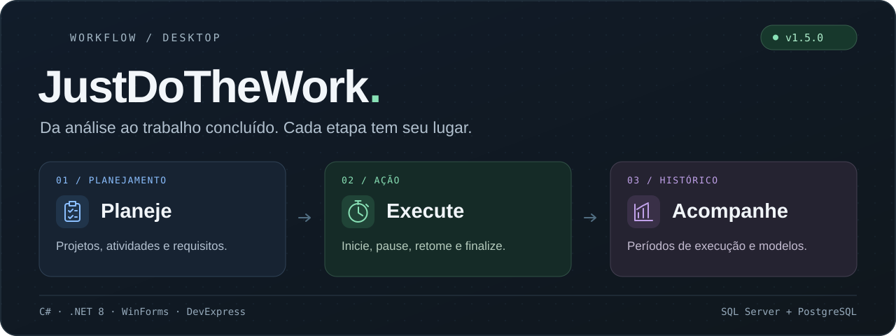
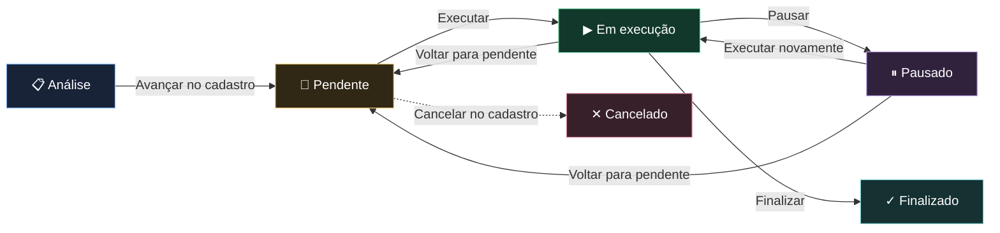
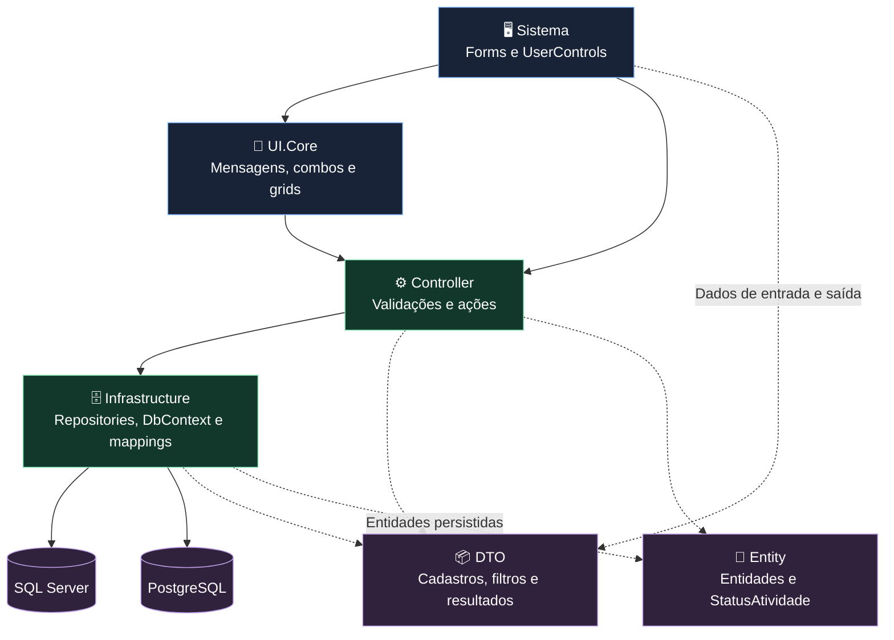

<p align="center">
  
</p>

# JustDoTheWork

**Organize a atividade. Execute com contexto. Acompanhe cada etapa.**

O JustDoTheWork é uma aplicação desktop para Windows que reúne projetos, atividades, registros de execução e cadastros em um só lugar. Você descreve o que precisa ser feito, acompanha o trabalho entre pendências, execução e pausas e consulta quando cada período de execução começou e terminou.

Desenvolvido em **C# e .NET 8**, com **Windows Forms**, **DevExpress** e persistência via **Entity Framework Core**, o projeto possui configurações para **SQL Server e PostgreSQL**.

<p align="center">
  <strong>Versão 1.5.0</strong> · Windows Desktop · Interface em português · Tema escuro
</p>

<p align="center">
  <a href="#funcionalidades">Funcionalidades</a> ·
  <a href="#fluxo">Fluxo de trabalho</a> ·
  <a href="#versao-150">Novidades da 1.5.0</a> ·
  <a href="#executar">Como executar</a> ·
  <a href="#arquitetura">Arquitetura</a>
</p>

---

<a id="funcionalidades"></a>

## 🧭 O que você pode fazer

| Área | Ações disponíveis |
| --- | --- |
| 🗂️ **Projetos e atividades** | Criar um projeto durante o cadastro da atividade; incluir atividades com nome, projeto e descrição formatada; consultar e editar seus dados. |
| 🔎 **Pesquisa de atividades** | Filtrar por nome, projeto, status e data de criação; limpar os filtros; abrir os detalhes pela ação da grid. |
| ▶️ **Painel de execução** | Visualizar atividades pendentes, em execução e pausadas; executar, pausar, retomar, voltar para pendente e finalizar. |
| 🕒 **Histórico** | Consultar os períodos de execução, com início e fim; pesquisar por projeto, status e data de criação da atividade. |
| 📝 **Modelos de relatório** | Incluir, pesquisar, editar e excluir modelos; definir seu tipo e ativação; editar o conteúdo em um editor de texto formatado. |
| 👥 **Usuários** | Incluir e editar usuários; pesquisar por nome ou logon; visualizar nome, logon e tipo na listagem. |
| 🔐 **Login** | Conferir o logon cadastrado e verificar a senha com BCrypt. |
| 🔌 **Banco de dados** | Selecionar SQL Server ou PostgreSQL, informar a conexão, testar o acesso e salvar a configuração. |

O menu lateral abre os cadastros e o relatório de execuções em abas. O painel principal reúne os três quadros de trabalho e atualiza suas listagens a cada **10 segundos**.

### Uma interface para acompanhar o trabalho

- **Pendentes, Em execução e Pausado:** três quadros para localizar a atividade e escolher a próxima ação.
- **Grids padronizadas:** mais espaço para textos, IDs e datas centralizados, coluna de ação à direita e larguras ajustadas ao espaço disponível.
- **Detalhes da atividade:** dados do cadastro, descrição e consulta ao histórico de execução.
- **Editor compartilhado:** conteúdo formatado para descrever requisitos e preparar modelos de relatório.
- **Mensagens em português:** validações, confirmações e retornos das operações.

<a id="fluxo"></a>

## 🔄 Da análise à finalização

Uma nova atividade começa em **Análise**. Depois de revisar os dados e a descrição, a ação **Avançar** a envia para **Pendente**, disponibilizando-a no painel de execução.



| Ação | O que acontece |
| --- | --- |
| **Executar** | A atividade entra em execução e um registro recebe sua data e hora de início. |
| **Pausar** | O período de execução aberto recebe a data e hora de fim; a atividade passa para pausada. |
| **Retomar** | Executar uma atividade pausada inicia outro período, preservando os registros anteriores. |
| **Voltar para pendente** | A atividade retorna à fila. Quando parte de uma execução em andamento, esse período é encerrado. |
| **Finalizar** | A execução é encerrada e a atividade recebe o status finalizado e a data de finalização. |
| **Cancelar** | Na tela de detalhes do cadastro, a ação disponível altera o status para cancelado e registra a data de encerramento da atividade. |

O desenho apresenta o fluxo principal e um caminho de cancelamento pelo cadastro. As ações do painel validam as transições entre os estados. A alteração do status e o registro de execução são realizados dentro da mesma transação de banco de dados.

**Exemplo:** você executa uma atividade pela manhã, pausa para uma reunião e retoma depois. O histórico preserva os dois períodos de execução, permitindo consultar seus horários separadamente.

<a id="versao-150"></a>

## ✨ O que chegou na versão 1.5.0

- **Gestão de usuários:** tela de inclusão e edição, busca por nome ou logon, listagem e acesso pelo menu lateral.
- **Tipos de usuário:** Historiador, Desenvolvedor, QA Tester e Tech Lead, utilizando os IDs já existentes no banco.
- **Senhas com BCrypt:** geração de hash ao cadastrar ou trocar a senha e verificação no login. Na edição, deixar a senha em branco mantém a senha atual.
- **Cancelamento de atividades:** ação na tela de detalhes do cadastro.
- **Apresentação das grids:** alinhamentos, proporções de colunas e disposição dos quadros de execução ajustados.
- **Nomenclatura consistente:** nomes de telas, componentes, eventos, métodos e variáveis padronizados, com regras registradas na documentação e na `.editorconfig`.

<a id="uso"></a>

## 🖱️ Um roteiro para conhecer o sistema

1. **Prepare e configure o banco.** Informe o provedor e os dados de conexão na primeira abertura. Salve e reinicie o aplicativo.
2. **Entre no sistema.** Use um usuário do banco com senha no formato BCrypt; consulte as orientações de primeiro acesso abaixo.
3. **Crie sua primeira atividade.** Acesse **Cadastro → Atividades → Incluir**, selecione um projeto ou crie um pelo botão de adicionar projeto e preencha a descrição.
4. **Revise e avance.** Abra a atividade pela ação da grid e use **Avançar** para enviá-la ao quadro de pendentes.
5. **Execute o trabalho.** Na aba **Execução de Tarefas**, selecione a atividade e use os botões para executar, pausar, voltar para pendente ou finalizar.
6. **Consulte os registros.** Acesse **Relatório → Relatório de Execuções**, informe os filtros e pesquise os períodos registrados.
7. **Personalize os cadastros.** Em **Cadastro**, organize os usuários e os modelos de relatório que serão utilizados.

### Modelos de relatório nesta versão

O botão **Imprimir** da tela de histórico busca um modelo ativo do tipo de histórico de execução e o abre no editor de texto. O conteúdo pode ser revisado nesse editor. A montagem automática do relatório com as linhas pesquisadas ainda precisa ser implementada.

<a id="executar"></a>

## 🚀 Como executar

### Requisitos

| Requisito | Utilização |
| --- | --- |
| **Windows** | Execução da interface, cujo projeto utiliza `net8.0-windows`. |
| **SDK do .NET 8** | Compilação dos projetos da solução. |
| **Visual Studio com desenvolvimento desktop em .NET** | Abertura da solução e edição dos formulários Windows Forms. |
| **DevExpress 25.2.5** | Componentes visuais e editor de documentos. É necessário ter acesso aos pacotes da versão, pela fonte NuGet da licença ou pelos pacotes locais da instalação. |
| **SQL Server ou PostgreSQL** | Banco acessível, com as tabelas e os dados iniciais preparados. |

### 1. Obtenha o projeto

```powershell
git clone https://github.com/devsousaleon/JustDoTheWork.git
cd JustDoTheWork
```

Abra [JustDoTheWork.sln](JustDoTheWork.sln) no Visual Studio e selecione **JustDoTheWork.Sistema** como projeto de inicialização.

### 2. Prepare o banco de dados

Crie um banco no provedor escolhido e prepare as tabelas conforme os mappings de [SQL Server](JustDoTheWork.Infrastructure/Mappings/SqlServer/) ou [PostgreSQL](JustDoTheWork.Infrastructure/Mappings/Postgres/):

```text
Projeto ─────── Atividade ─────── Execucao

TipoUsuario ─── Usuario

TipoModelo ──── ModeloRelatorio
```

O arquivo [justdothework_sql.sql](justdothework_sql.sql) reúne comandos históricos dos dois provedores e precisa de revisão antes de ser usado para preparar a **1.5.0**. A aplicação espera o schema existente; atualmente não há migrations ou criação automática do banco na inicialização.

Ao preparar esse script:

- Execute apenas os comandos do provedor escolhido e confirme o banco de destino.
- Revise as chaves estrangeiras e os `INSERT`s, informando as colunas explicitamente.
- Utilize tipos binários para `Atividade.Descricao` e `ModeloRelatorio.Texto`: `VARBINARY(MAX)` no SQL Server ou `BYTEA` no PostgreSQL. Esses campos armazenam documentos Open XML.
- Para PostgreSQL, inclua também `usuario` e `tipousuario`, seguindo os mappings atuais.
- Cadastre os quatro tipos de usuário: **Historiador**, **Desenvolvedor**, **QA Tester** e **Tech Lead**. O cadastro de usuários consulta os respectivos IDs no banco.
- Prepare o tipo de modelo **Histórico Execução** com **ID 1**, pois a consulta do modelo ativo de histórico utiliza esse ID na versão atual.

### 3. Restaure os pacotes e inicie

Com a fonte dos pacotes DevExpress configurada, execute pelo Visual Studio ou utilize:

```powershell
dotnet restore JustDoTheWork.sln
dotnet build JustDoTheWork.sln -m:1
dotnet run --project JustDoTheWork.Sistema/JustDoTheWork.Sistema.csproj
```

### 4. Configure a conexão

Sem uma conexão configurada, a aplicação abre **Configuração de Banco**:

1. Selecione **SQL Server** ou **PostgreSQL**.
2. Preencha servidor, banco, usuário e senha do banco.
3. Use **Testar conexão** para conferir o acesso.
4. Salve a configuração e reinicie o aplicativo, conforme a mensagem exibida.

A configuração salva utiliza a proteção `DataProtectionConfigurationProvider` do Windows. O usuário e a senha desta tela são credenciais do **banco de dados**; o login da aplicação usa os registros da tabela **Usuario**.

### 5. Primeiro acesso e usuários

Após acessar a interface, abra **Cadastro → Usuários → Incluir** para criar um usuário com nome, logon, senha e tipo. Cadastros e trocas de senha feitos pela tela geram o hash BCrypt automaticamente.

<details>
<summary><strong>Acesso de demonstração presente na 1.5.0</strong></summary>

A implementação atual de [FormLogin](JustDoTheWork.Sistema/Forms/FormLogin.cs) contém um atalho de desenvolvimento com logon `adm` e senha `admin@123`. Esse trecho abre a interface e continua a consulta do usuário no banco, podendo exibir uma mensagem de credenciais inválidas quando o registro não existe.

Revise esse atalho antes de utilizar a aplicação em um ambiente real. O fluxo de login dos usuários cadastrados consulta o logon e verifica o hash BCrypt armazenado.

</details>

Os tipos de usuário representam a classificação do cadastro. A versão atual ainda não aplica permissões diferentes por tipo. Usuários antigos com senha em texto precisam ter a senha atualizada pela tela de cadastro para utilizar a verificação BCrypt.

<a id="arquitetura"></a>

## 🏗️ Como o projeto está organizado

A solução separa a interface, os dados transportados entre as camadas, as entidades, as ações dos controllers e o acesso ao banco.



| Projeto | Responsabilidade |
| --- | --- |
| [JustDoTheWork.Sistema](JustDoTheWork.Sistema/) | Inicialização, login, menu, formulários e UserControls. |
| [JustDoTheWork.Controller](JustDoTheWork.Controller/) | Validações, operações de cadastro, transições do painel e composição dos controllers. |
| [JustDoTheWork.DTO](JustDoTheWork.DTO/) | Objetos de cadastro, filtros de pesquisa e resultados das consultas. |
| [JustDoTheWork.Entity](JustDoTheWork.Entity/) | Entidades persistidas e enumeração dos status das atividades. |
| [JustDoTheWork.Infrastructure](JustDoTheWork.Infrastructure/) | Repositories, Entity Framework Core, configuração dos provedores e mappings. |
| [JustDoTheWork.UI.Core](JustDoTheWork.UI.Core/) | Serviços compartilhados de mensagens, combos e apresentação das grids. |

O acesso aos dados dos cadastros e das pesquisas utiliza **Entity Framework Core e LINQ**. Os mappings de cada provedor definem tabelas, colunas e relacionamentos. A `CompositionRoot` monta os controllers e repositories a partir da conexão selecionada.

### Tecnologias da versão

| Tecnologia | Papel no projeto |
| --- | --- |
| **C# / .NET 8** | Linguagem e plataforma da aplicação. |
| **Windows Forms** | Interface desktop para Windows. |
| **DevExpress 25.2.5** | Formulários, grids, menu, abas e editor de documentos. |
| **Entity Framework Core 8** | Persistência, consultas e transações. |
| **SQL Server / Npgsql** | Provedores de acesso aos bancos SQL Server e PostgreSQL. |
| **BCrypt.Net-Next 4.2.0** | Geração e verificação dos hashes de senha. |
| **System.Configuration** | Leitura, gravação e proteção da configuração de conexão. |

## 🤝 Para quem quiser contribuir

O projeto é desenvolvido para estudo e prática de desenvolvimento desktop. Sugestões, relatos de problemas e melhorias podem ser enviados pelas [issues do repositório](https://github.com/devsousaleon/JustDoTheWork/issues).

Ao alterar o código, siga os [padrões de nomenclatura](docs/PADROES_NOMENCLATURA.md), atualize componentes e eventos junto com o Designer e confira o comportamento no provedor de banco utilizado. Explique nas contribuições a mudança realizada e como ela foi verificada.

O repositório ainda não possui um arquivo `LICENSE` com uma licença de uso definida.

---

<p align="center">
  Desenvolvido por <a href="https://github.com/devsousaleon">devsousaleon</a>.<br>
  <strong>Do planejamento ao histórico: cada etapa do trabalho tem seu lugar.</strong>
</p>
